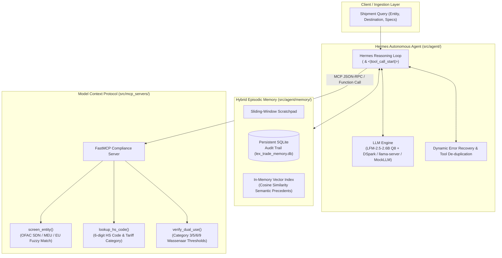
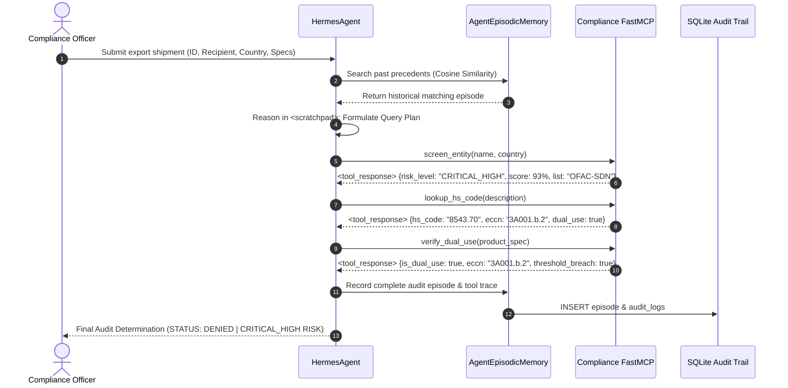

# `lex-trade-agent`: Autonomous Trade Compliance & Export Control Agent

[](https://www.python.org/)
[](https://opensource.org/licenses/Apache-2.0)
[]()
[]()
[-8A2BE2.svg)]()

`lex-trade-agent` is an autonomous enterprise agent for trade compliance screening, export controls classification, and dual-use audits under **EU Dual-Use Regulation (Regulation (EU) 2021/821 Annex I)** and the **Wassenaar Arrangement**.

Engineered around the **Hermes ReAct Plan-and-Solve architecture**, the **Model Context Protocol (FastMCP)**, and **hybrid episodic memory**, the agent autonomously reasons through ambiguous regulatory thresholds, enforces non-lexical evaluation, and triggers human-in-the-loop escalation when critical sanction violations or dual-use threshold breaches occur.

---

## Key Capabilities

- **Autonomous ReAct Reasoning Loop**: Multi-turn Plan-and-Solve engine using structured scratchpad thoughts (`<scratchpad>`) and multi-syntax tool execution.
- **Multi-Syntax Tool Protocol Support**:
  - Liquid AI / Hermes special tokens: `<|tool_call_start|>[tool_name(arg='val')]<|tool_call_end|>`
  - XML tool call blocks: `<tool_call>{"name": "tool_name", "arguments": {...}}</tool_call>`
  - Parallel multi-tool execution with automatic duplicate suppression and tool validation.
- **FastMCP Compliance Tools**:
  - `screen_entity(name, country)`: Fuzzy token screening against OFAC SDN, Russian Military End-User (MEU), and EU Consolidated sanctions lists.
  - `lookup_hs_code(description)`: 6-digit Harmonized System (HS) code classification and ECCN mapping.
  - `verify_dual_use(product_spec)`: Rigorous threshold checks across Category 3 (Electronics/MMIC), Category 5 (Cryptography/AES), Category 6 (Sensors/Optics), and Category 9 (Aerospace/Drones).
- **Hybrid Episodic Memory**:
  - Short-term sliding-window scratchpad.
  - Long-term SQLite non-repudiation audit journal (`lex_trade_memory.db`).
  - TF-IDF / trigram vector semantic retrieval for precedent search and reuse.
- **High-Performance Local LLM Serving**:
  - Pre-configured for **LFM-2.5-2.6B-Instruct Q8** with **DSpark Speculative Decoding** (`--spec-type draft-dspark`) on port `5813`.
  - Zero-config fallback to deterministic `MockLLMClient` when no live LLM endpoint is active.

---

## Architecture Overview



---

## MCP Protocol Flow



---

## Directory Layout

```text
lex-trade-agent/
├── src/
│   ├── __init__.py
│   ├── mcp_servers/
│   │   ├── __init__.py
│   │   └── compliance_mcp.py        # FastMCP server exposing 3 compliance tools
│   ├── database/
│   │   ├── __init__.py
│   │   ├── schema.sql               # SQLite schema with indexes for episodes and audit_logs
│   │   └── seed_sample_data.py      # Seeder script populating historical compliance episodes
│   ├── agent/
│   │   ├── __init__.py
│   │   ├── hermes_orchestrator.py   # Autonomous Hermes ReAct engine with multi-syntax tool parsing
│   │   ├── memory/
│   │   │   ├── __init__.py
│   │   │   └── hybrid_memory.py     # Episodic memory with SQLite + vector semantic search
│   │   └── skills/
│   │       └── SKILL_DUAL_USE_AUDIT.md # Self-improving compliance reasoning skill definition
│   ├── ui/
│   │   ├── __init__.py
│   │   └── app.py                   # Streamlit compliance cockpit with dynamic module reloading
│   └── eval/
│       ├── __init__.py
│       └── agent_eval.py            # 4-Pillar non-lexical agent evaluation benchmark
├── tests/
│   ├── __init__.py
│   ├── test_mcp_tools.py            # Unit tests for MCP server tools
│   └── test_orchestrator.py         # End-to-end test with MockLLM and live client
├── docker/
│   ├── Dockerfile                   # Sandboxed container for agent code & shell tasks
│   └── docker-compose.yml           # Orchestrated multi-container stack
├── lex_trade_memory.db              # SQLite memory & audit journal database
├── pyproject.toml                   # Poetry/pip configuration with strict dependencies
├── .env                             # Local environment variables (Port 5813 configuration)
├── .env.example                     # Reference environment variables template
└── README.md                        # Architecture, setup instructions, and quickstart guide
```

---

## Configuration & Environment Variables

Create or update `.env` in the project root:

```ini
# LLM Endpoint Configuration
# Pointed to local LFM-2.5-2.6B-Instruct Q8 server on port 5813
LLM_API_URL=http://127.0.0.1:5813/v1
LLM_API_KEY=local-dev-key
LLM_MODEL=LFM-2.5-2.6B-Instruct-Q8_0

# Standard OpenAI-Compatible Fallback
OPENAI_BASE_URL=http://127.0.0.1:5813/v1
OPENAI_API_KEY=local-dev-key
OPENAI_MODEL=LFM-2.5-2.6B-Instruct-Q8_0

# Set to 'true' to force offline mock reasoning without live LLM calls
FORCE_MOCK_LLM=false
```

---

## Running the Local LLM Server (Port 5813)

For maximum inference speed with zero quality loss, launch **Liquid AI LFM-2.5-2.6B-Instruct Q8** paired with the **DSpark drafter** via `llama-server.exe`:

```powershell
C:\Tools\llama-tools\llama-server.exe `
  -m "C:\Hub\Models\LFM-2.5-2.6B-Instruct\LFM2.5-2.6B-Q8_0.gguf" `
  -md "C:\Hub\Models\LFM-2.5-2.6B-Instruct\LFM2.5-2.6B-DSpark-Q8_0.gguf" `
  --spec-type draft-dspark `
  --port 5813 -c 32768 --flash-attn -ctk q8_0 -ctv q8_0 --cache-reuse 256 -ngl 99
```

> **Note:** If no local LLM server is active, `lex-trade-agent` automatically falls back to `MockLLMClient` without throwing errors.

---

## Quickstart Guide

### 1. Installation
```bash
# Clone or navigate to the repository
cd C:\Git\JOBs\aie\lex-trade-agent

# Install dependencies
pip install pydantic mcp httpx numpy streamlit python-dotenv pytest pytest-asyncio
```

### 2. Launch the Streamlit Live Compliance Cockpit (UI)
Launch the interactive web cockpit on `http://localhost:8501`:
```bash
streamlit run src/ui/app.py
```
- Includes 1-click manifest presets:
  - 🚨 **Sanctioned Entity (Vektor RU)**: High-risk OFAC-SDN + dual-use GaN MMIC module (expected: `STATUS: DENIED`).
  - ⚡ **Chinese CMIC Semiconductor**: Multi-core DSP with 55 GHz coprocessor (expected: `DUAL_USE_RESTRICTED`).
  - 🛡️ **Cryptographic Gateway**: Hardware-accelerated AES-256 router (expected: `DUAL_USE_RESTRICTED`).
  - ✅ **Commercial Laptops (Cleared)**: Standard consumer business laptops (expected: `CLEARED / NLR`).

### 3. Run the CLI Demo
Execute an end-to-end audit directly from the terminal:
```bash
python -m src.agent.hermes_orchestrator
```

### 4. Run the 4-Pillar Non-Lexical Benchmark
Benchmark the agent's decision accuracy, token efficiency, and tool usage:
```bash
python -m src.eval.agent_eval
```

### 5. Run the Test Suite
Execute the full pytest suite (14 tests):
```bash
pytest -v
```

### 6. Re-Seed Historical Precedents (Optional)
Populate clean baseline compliance episodes into SQLite:
```bash
python -m src.database.seed_sample_data
```

### 7. Docker Sandboxed Execution
Run inside isolated containers with non-root security boundaries:
```bash
cd docker
docker compose up --build
```
