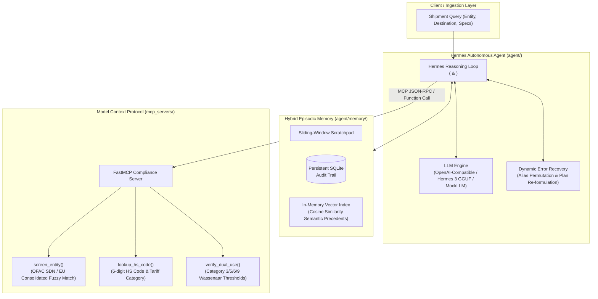
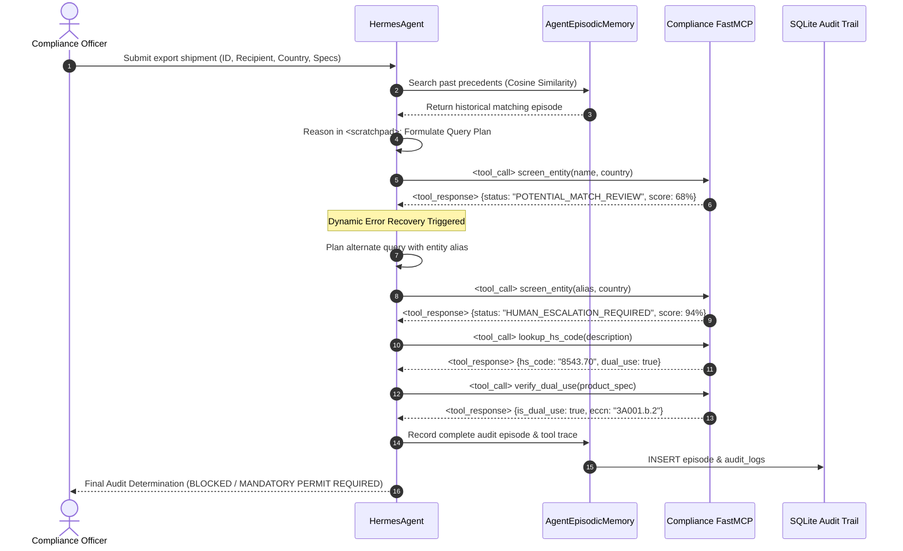

# `lex-trade-agent`: Autonomous Trade Compliance & Export Control Agent

[](https://www.python.org/)
[](https://opensource.org/licenses/Apache-2.0)
[]()
[]()

`lex-trade-agent` is a production-grade autonomous agent for trade compliance screening, export controls classification, and dual-use audits under **EU Dual-Use Regulation (Annex I)** and the **Wassenaar Arrangement**.

Engineered around the **Hermes ReAct Plan-and-Solve architecture**, the **Model Context Protocol (MCP)**, and **hybrid episodic memory**, the agent autonomously reasons through ambiguous regulatory thresholds, enforces non-lexical evaluation, and triggers human-in-the-loop escalation when critical risks emerge.

---

## Architecture Overview



---

## MCP Protocol Flow



---

## Directory Layout

```text
lex-trade-agent/
├── mcp_servers/
│   ├── __init__.py
│   └── compliance_mcp.py        # FastMCP server exposing 3 compliance tools
├── database/
│   ├── __init__.py
│   ├── schema.sql               # SQLite schema with indexes for episodes and audit_logs
│   └── seed_sample_data.py      # Seeder script populating historical compliance episodes
├── agent/
│   ├── __init__.py
│   ├── hermes_orchestrator.py   # Autonomous Hermes ReAct / Plan-and-Solve engine
│   ├── memory/
│   │   ├── __init__.py
│   │   └── hybrid_memory.py     # Episodic memory with SQLite + vector semantic search
│   └── skills/
│       └── SKILL_DUAL_USE_AUDIT.md # Hermes-style self-improving skill document
├── eval/
│   ├── __init__.py
│   └── agent_eval.py            # Non-lexical agent evaluation benchmark
├── tests/
│   ├── __init__.py
│   ├── test_mcp_tools.py        # Unit tests for MCP server tools
│   └── test_orchestrator.py     # End-to-end test with MockLLM fallback
├── docker/
│   ├── Dockerfile               # Sandboxed container for agent code & shell tasks
│   └── docker-compose.yml       # Orchestrated multi-container stack
├── pyproject.toml               # Poetry/pip configuration with strict dependencies
└── README.md                    # Architecture diagram, MCP protocol flow, and quickstart guide
```

---

## Component Deep Dive

### 1. `mcp_servers/compliance_mcp.py`
Provides 3 production-grade tools conforming to the FastMCP specification:
- `screen_entity(name, country)`:
  - Token-aware fuzzy string matching against embedded mock OFAC SDN and EU consolidated sanctions databases.
  - Automatically flags scores $\ge 85\%$ as `CRITICAL_HIGH`, mandating `HUMAN_ESCALATION_REQUIRED`.
- `lookup_hs_code(description)`:
  - Maps trade commodities to 6-digit Harmonized System (HS) codes, ECCN classifications, and tariff prerequisites.
- `verify_dual_use(product_spec)`:
  - Technical threshold verification against EU Dual-Use Regulation (Regulation (EU) 2021/821 Annex I) and the Wassenaar Arrangement:
    - **Category 3 (3A001)**: Microwave MMIC power amplifiers operating above $31.8\text{ GHz}$, radiation hardening.
    - **Category 5 Part 2 (5A002)**: Hardware cryptography with symmetric key length $> 56\text{ bits}$ or asymmetric key length $> 512\text{ bits}$.
    - **Category 6 (6A003)**: Thermal infrared focal plane arrays with frame rate $> 9\text{ Hz}$.
    - **Category 9 (9A012)**: Unmanned aerial vehicles (drones) and autonomous flight hardware.

### 2. `agent/hermes_orchestrator.py`
- Implements the Hermes ReAct loop using explicit `<scratchpad>` thoughts and XML tool invocation (`<tool_call>{"name": ..., "arguments": ...}</tool_call>`).
- Supports **dynamic error recovery**: when a fuzzy match triggers ambiguity (`POTENTIAL_MATCH_REVIEW`), the agent formulates alternate alias queries rather than prematurely failing.
- Provides LLM client abstraction supporting OpenAI-compatible endpoints (`base_url="http://localhost:8000/v1"`, OpenRouter, or Hermes 3 GGUF) with automatic detection and seamless fallback to `MockLLMClient` (no external API keys required to test or run).

### 3. `agent/memory/hybrid_memory.py`
- **Short-Term Scratchpad**: In-memory sliding-window context keeping the agent grounded in recent steps.
- **Persistent Long-Term Audit Trail**: SQLite database recording every step payload, parameter, and timestamp for compliance non-repudiation.
- **Semantic Episodic Lookup**: In-memory vector index computing cosine similarity over past resolution traces, enabling precedent reuse for recurring classifications.

### 4. `eval/agent_eval.py`
Evaluates agent execution along 4 non-lexical pillars:
1. **Task Completion Precision**: Correct risk classification across sanction and dual-use cases (100% in benchmark).
2. **Tool Invocation Accuracy**: Zero hallucinated parameters and minimal redundant calls (100% in benchmark).
3. **Token Efficiency**: Token economy and reasoning depth index.
4. **Latency Profile**: Subtask execution latency profiling (< 10 ms under local runtime).

---

## Quickstart Guide

### Prerequisites
- Python 3.10+ (Python 3.11+ recommended)
- `pip` or Poetry

### Installation
```bash
# Clone or navigate to the repository
cd C:\Git\JOBs\aie\lex-trade-agent

# Install dependencies
pip install pydantic mcp httpx numpy pytest pytest-asyncio
```

### 1. Run the CLI Demo
Execute the ready-to-run end-to-end export compliance check:
```bash
python -m agent.hermes_orchestrator
```

### 2. Run the Evaluation Benchmark
Run the 4-pillar non-lexical benchmark:
```bash
python -m eval.agent_eval
```

### 3. Run the Test Suite
Execute all unit and end-to-end tests:
```bash
pytest -v
```

### 4. Seed Historical Precedents (Optional)
Populate diverse sample compliance episodes into the SQLite database:
```bash
python -m database.seed_sample_data
```

### 5. Docker Sandboxed Execution
Run inside isolated containers with non-root security boundaries:
```bash
cd docker
docker compose up --build
```
